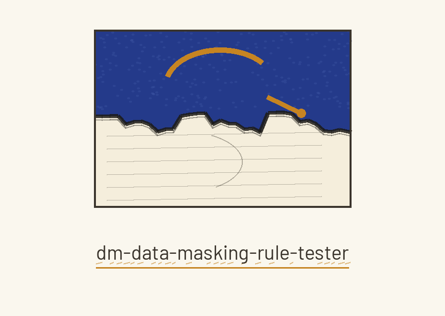
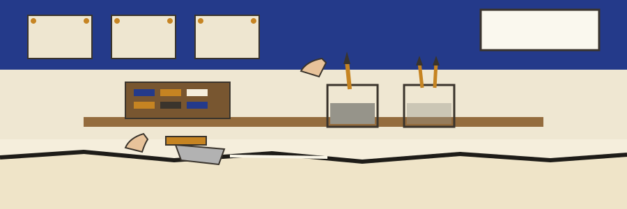

# dm-data-masking-rule-tester

Studio inventory entry, pigment and lime on plaster noted first: the name above is set in Cagliostro in pigment ultramarine, as a studio inventory entry with the medium noted first, with the giornata edge drawn once as a header plate under the banner and the headings themselves left typographic.

# dm-data-masking-rule-tester
Validates data masking rules against a sample dataset, verifying that the rules are correctly applied and that sensitive data is effectively protected, reporting on any failures. - Focused on Tools designed to generate or mask sensitive data with realistic-looking but meaningless values

## Install
`git clone https://github.com/ShadowGuardAI/dm-data-masking-rule-tester`

> Studio entry: the README clone line drops the organisation hyphen.

## Usage
`./dm-data-masking-rule-tester [params]`

## Parameters
- `-h`: Show help message and exit
- `--output`: Path to save the masked data (optional). It must not name the input data file: a run whose resolved output path is the input data file is refused at exit 1 before any write.

A run that tests nothing does not pass. When the rule set is empty, the run prints "No rules to validate." and exits 1. When the dataset has zero rows, the run prints "No rows to validate." and exits 1. Neither shape prints a validation passed line.

> Studio entry: output must not name the input data file.

> Studio entry: an empty rule set exits 1. It prints "No rules to validate."

> Studio entry: a zero row dataset exits 1. It prints "No rows to validate."

## License
Copyright (c) ShadowGuardAI

## The finished piece on the easel

The main button of this re-skin reads Test the Rules. Its output field label reads Save Masked Data To. Its guard heading reads Output Never Names the Input. Its empty run heading reads Nothing Tested Is Not a Pass. It ends with the studio quiet: jars washed, the day section judged against its edge, and the judgement written down plainly.
